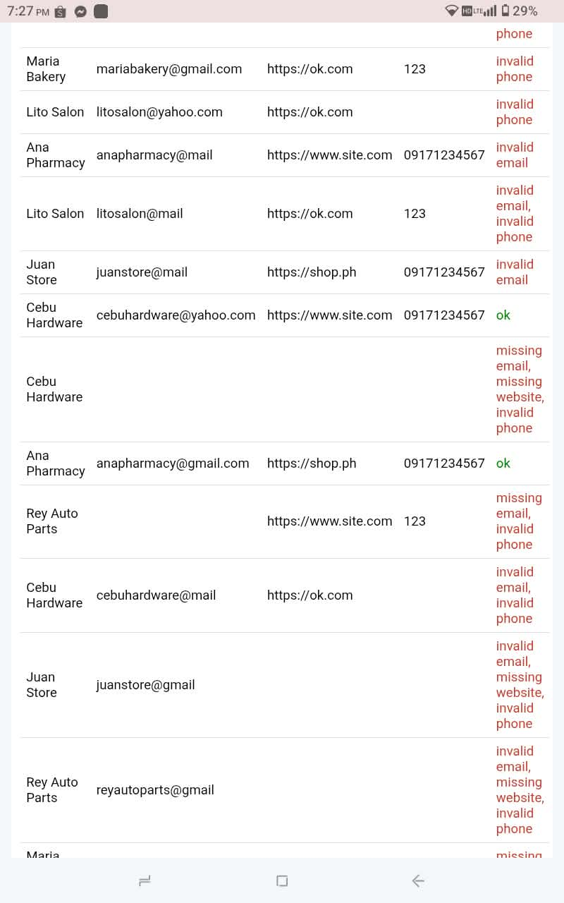
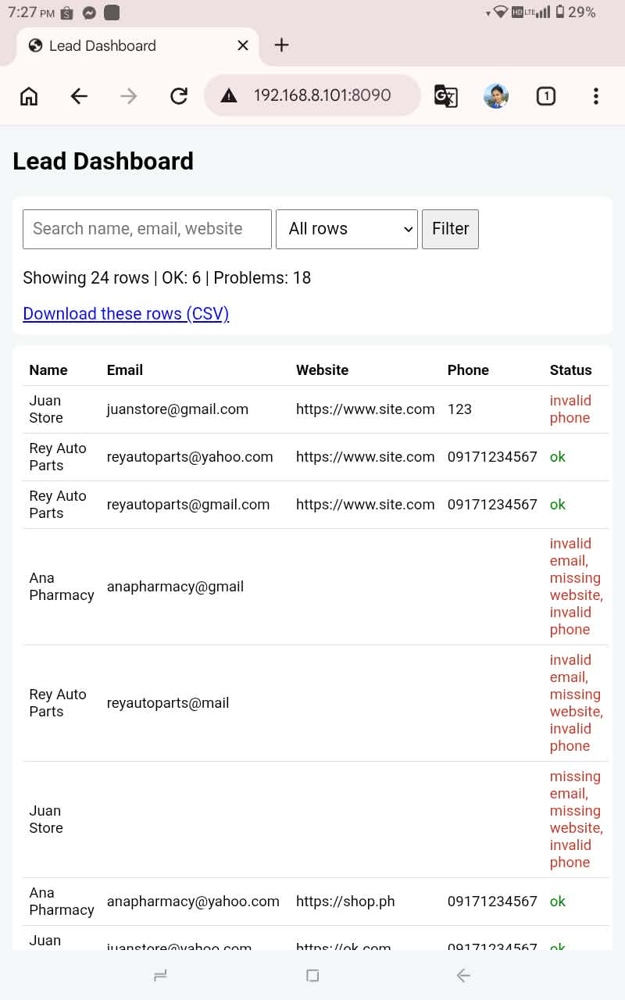

# Lead List Cleaner

Python script that cleans a messy lead list CSV (company, email, website, phone).

## What it does
- Removes duplicate rows
- Trims extra spaces and fixes name casing
- Validates email and phone format
- Adds https:// to websites
- Flags missing or invalid fields in a status column
- Saves clean.csv and report.txt

## Before
    JUAN STORE  ,juanstore@gmail,www.site.com,0917 123 4567
    Ana Pharmacy,,,123

## After
    Juan Store,juanstore@gmail,https://www.site.com,09171234567,invalid email
    Ana Pharmacy,,,123,"missing email, missing website, invalid phone"

## Sample result
    Total rows: 68 | Duplicates removed: 44 | Clean rows: 24
    Websites fixed: 10 | Invalid emails: 9 | Invalid phones: 15

## How to run
    python make_data.py   (creates a fake messy.csv)
    python cleaner.py     (creates clean.csv and report.txt)

Sample data is fake. Python 3 only, no extra packages.

## SQL practice
Loads clean.csv into SQLite and practices queries on it.

    python sql_practice.py   (loads the data, runs 4 example queries)
    python my_sql.py         (practice: SELECT, WHERE, LIKE, JOIN)
    python my_sql2.py        (practice: ORDER BY, HAVING, UPDATE, DELETE on a safe copy)

Covers: SELECT, WHERE, LIKE, ORDER BY, GROUP BY, HAVING, JOIN, UPDATE, DELETE.

## Lead Dashboard

A small Flask web page that shows the cleaned leads (`clean.csv`).

Features:
- Search by name, email or website
- Filter: all rows, ok, or problems
- Counts of ok and problem rows
- Download the filtered rows as CSV

Run it:

    python dashboard.py

Then open http://127.0.0.1:8090 in your browser. To open it from another device on the same Wi-Fi, use the phone's Wi-Fi address with port 8090.

### Screenshots

